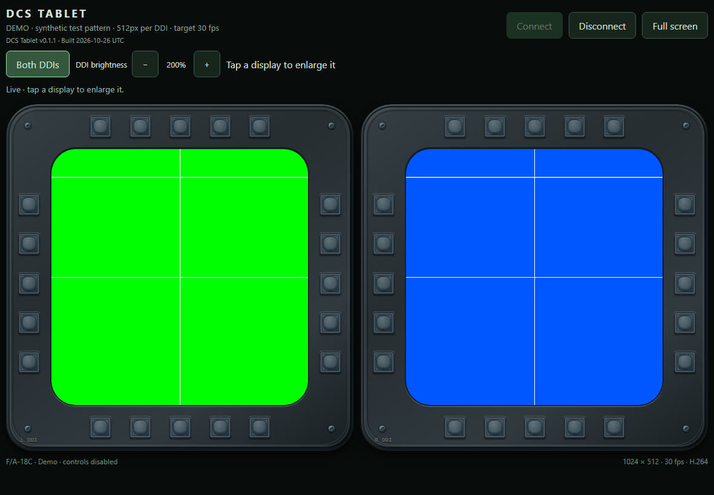

# DCS Tablet

DCS Tablet shows two aircraft displays on your tablet.
You can touch their buttons to operate the same buttons in DCS World.

**Initial aircraft support is for the F-18 only: the DCS F/A-18C Hornet.**

Version: **0.1.1**. Status: **development version**.
Earlier builds passed live DCS cockpit checks for video, touch controls, reconnection, and normal-exit display restoration.
The safety patch has its own validation record in [Test record](docs/validation.md).
An earlier build also passed a user-reported iPad Safari test; Safari has not been retested after the latest changes.
Extended tablet tests and a complete DCS flight test are still necessary.

## What you need for a flight

- A Windows 10 or Windows 11 x64 PC with DCS World installed.
- The Microsoft Visual C++ v14 x64 Redistributable.
- Windows Media Foundation. Windows N editions need the Media Feature Pack.
- The DCS F/A-18C Hornet module for a flight.
- A tablet with a web browser.
- A private home network for both devices.
- A virtual display for a flight.

The demo does not need DCS World or a virtual display.
The Windows package does not need a Rust or Python installation.

## Start here

**[Download Windows 0.1.1](https://github.com/dcssimcoding/dcstablet/releases/download/v0.1.1/dcs-tablet-0.1.1-windows-x64.zip)**, then follow the [user guide](docs/user-guide.md).
Before setup, read [Data safety](docs/data-safety.md) and keep a separate backup of your normal Saved Games profile.
After extracting the Windows package, you can also open `START-HERE.html` for the complete offline guide.

| Task | Instructions |
| --- | --- |
| Extract the package and do the demo test | [User guide](docs/user-guide.md) |
| Add space for the aircraft displays | [Virtual display](docs/virtual-display.md) |
| Connect the PC and tablet | [Network connection](docs/network.md) |
| Find the cause of a problem | [Problem guide](docs/troubleshooting.md) |
| Restore the display or remove DCS Tablet | [Recovery and removal](docs/removal.md) |
| Use a different installation folder | [Command examples](docs/commands.md) |
| Find the meaning of a term | [Glossary](docs/glossary.md) |

## What this version supports

| Item | Support |
| --- | --- |
| Aircraft | DCS F/A-18C Hornet only |
| Aircraft displays | Left DDI and right DDI |
| Aircraft buttons | 20 touch buttons around each DDI |
| Connected viewers | One at a time |
| Tablet position | Landscape only |
| VR | No support |

DDI means Digital Display Indicator.
Landscape means that the long side of the tablet is horizontal.
Other cockpit panels are outside the scope of this version.

Example: The demo shows two colored test displays.
It does not show a live aircraft.

## Important connection information

DCS Tablet has no password or tablet approval step.
A device with network access to the application can request a connection.
A connected viewer can operate the DDI buttons during a flight.

Use DCS Tablet only on a private network with devices that you trust.
Do not make the application available through your router's port forwarding settings.

The application uses HTTP for its page and control messages.
WebRTC encrypts the video connection.
[Network connection](docs/network.md) gives the setup instructions and the limits of this protection.

## Information for developers

- [Build and test instructions](CONTRIBUTING.md).
- [Technical description](docs/architecture.md).
- [Test record](docs/validation.md).
- [Documentation writing guide](docs/writing-guide.md).
- [Version history](CHANGELOG.md).

## License

DCS Tablet uses the [MIT License](LICENSE).
[Third-party notices](THIRD-PARTY-NOTICES.md) identify the software components and their license information.

Eagle Dynamics does not develop this community project.
